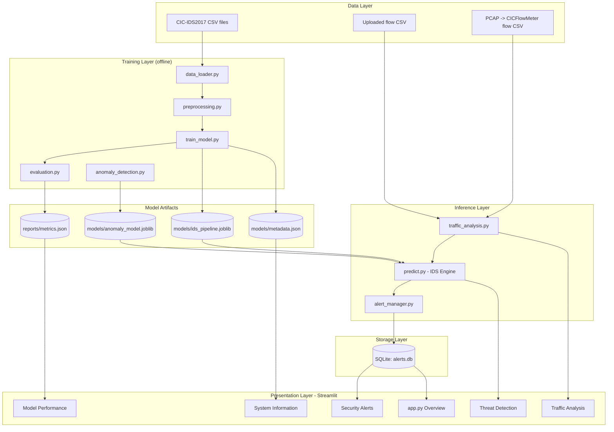

# AI-Powered Network Intrusion Detection System (IDS)

**Project type:** College Information Security Project (Machine Learning + Cybersecurity + Full-Stack Python)
**Document type:** Complete Project Specification and Implementation Blueprint
**Primary language:** Python 3.11 (3.10–3.12 compatible)
**Interface:** Streamlit multi-page dashboard
**Dataset:** CIC-IDS2017 (Canadian Institute for Cybersecurity, University of New Brunswick)

---

## Table of Contents

1. [Abstract](#1-abstract)
2. [Problem Statement](#2-problem-statement)
3. [Objectives and Scope](#3-objectives-and-scope)
4. [Technical Specification Summary](#4-technical-specification-summary)
5. [System Architecture](#5-system-architecture)
6. [Project Structure](#6-project-structure)
7. [Dataset Specification](#7-dataset-specification)
8. [Machine Learning Pipeline Specification](#8-machine-learning-pipeline-specification)
9. [Module Specifications](#9-module-specifications)
10. [Risk Scoring Specification](#10-risk-scoring-specification)
11. [Alert Management and Database Specification](#11-alert-management-and-database-specification)
12. [Dashboard and UI Specification](#12-dashboard-and-ui-specification)
13. [Wireshark and Scapy Integration](#13-wireshark-and-scapy-integration)
14. [Security and Reliability Requirements](#14-security-and-reliability-requirements)
15. [Testing Specification](#15-testing-specification)
16. [Installation and Execution Guide](#16-installation-and-execution-guide)
17. [Evaluation Methodology and Results Reporting](#17-evaluation-methodology-and-results-reporting)
18. [Limitations and Future Enhancements](#18-limitations-and-future-enhancements)
19. [Demonstration Guide for Presentation](#19-demonstration-guide-for-presentation)
20. [Development Workflow and Acceptance Criteria](#20-development-workflow-and-acceptance-criteria)
21. [Reference Implementation Code](#21-reference-implementation-code)
22. [Ethics, Legal and Authorized-Use Statement](#22-ethics-legal-and-authorized-use-statement)

---

## 1. Abstract

This project implements an **AI-Powered Network Intrusion Detection System (IDS)** that classifies network flow records as benign or malicious using supervised machine learning, supplemented by an unsupervised anomaly detector. Flow-level features (duration, packet counts, byte rates, flag counts, inter-arrival times) from the CIC-IDS2017 dataset are preprocessed through a leakage-safe pipeline, used to train and compare multiple classifiers, and served through a Streamlit security dashboard.

The system provides CSV-based traffic analysis, per-record attack-category prediction with confidence scores, a documented and configurable risk-scoring model, persistent alert management in SQLite (with status workflow, search, filtering and CSV export), and a model-evaluation section that reports **only metrics produced by actual experiments**. An optional workflow imports Wireshark/PCAP-derived flow data for analysis of authorized traffic.

A key design principle is **honesty about detection**: a model prediction is a *suspicion*, not a confirmed attack. The system labels results accordingly and requires analyst review through the alert workflow.

## 2. Problem Statement

Modern networks generate millions of flows per day. Signature-based IDS tools cannot detect novel attack variants, and manual log review does not scale. Machine-learning-based IDS can learn statistical patterns of malicious flows, but practical deployments face recurring problems:

- Severe **class imbalance** (benign traffic dominates; some attacks have only a handful of samples).
- **Data leakage** from fitting preprocessing on the full dataset, producing inflated results.
- **Over-optimistic evaluation** from random splits on temporally correlated flows.
- **Alert fatigue** from false positives and repeated alerts for the same event.
- **Lack of explainability** — analysts cannot see why a flow was flagged.

This project addresses these problems with a leakage-safe, reproducible, explainable ML-based IDS with analyst-oriented alert handling.

## 3. Objectives and Scope

### 3.1 Objectives

| ID | Objective |
|----|-----------|
| O1 | Classify network flows as benign or malicious. |
| O2 | Classify attack categories supported by the dataset (DoS, DDoS, PortScan, brute force, botnet, web attacks, etc.). |
| O3 | Train and compare ≥ 2 models (Random Forest, Logistic Regression; optional Gradient Boosting) and an Isolation Forest anomaly detector. |
| O4 | Assign explainable, configurable risk levels (Low / Medium / High / Critical). |
| O5 | Provide an interactive dashboard with statistics, filters and alerts. |
| O6 | Persist alerts in SQLite with a New → Investigating → Resolved workflow. |
| O7 | Evaluate with accuracy, precision, recall, F1, confusion matrix and per-class results on a held-out test set. |
| O8 | Support an optional, authorized Wireshark/PCAP-derived data import workflow. |
| O9 | Provide automated tests, documentation and a demonstration guide. |

### 3.2 In Scope

- Offline analysis of flow-feature CSV files (batch mode).
- Replay-style "real-time-style" alert display from analyzed batches.
- Model training, evaluation, persistence and inference.
- SQLite alert storage and CSV/report export.
- Offline PCAP → flow-feature conversion workflow (via CICFlowMeter or equivalent).

### 3.3 Out of Scope (explicitly)

- Active **intrusion prevention** (blocking traffic, firewall changes).
- Claiming true live, line-rate detection.
- Attack generation, exploitation or scanning of any network.
- Deep packet inspection or payload analysis.
- Detection of attack types not present in the training dataset (documented as unsupported).

## 4. Technical Specification Summary

| Area | Specification |
|------|---------------|
| Language | Python 3.11 |
| ML | scikit-learn ≥ 1.4, pandas ≥ 2.1, numpy ≥ 1.26 |
| Dashboard | Streamlit ≥ 1.32 |
| Visualization | Plotly ≥ 5.19 |
| Persistence (model) | joblib ≥ 1.3 |
| Persistence (alerts) | SQLite 3 via Python `sqlite3` (parameterized queries only) |
| Packet tooling | Wireshark (offline analysis), optional Scapy ≥ 2.5 (PCAP reading) |
| Testing | pytest ≥ 8.0, pytest-cov |
| Reproducibility | Global `RANDOM_SEED = 42`; pinned versions; saved training metadata |
| Max upload size | 200 MB default (configurable in `config.py`) |
| Supported input | CSV (UTF-8 / Latin-1 fallback) |
| Target inference throughput | ≥ 20,000 flows/s batch inference on a typical laptop with Random Forest (to be measured and reported, not assumed) |

## 5. System Architecture

### 5.1 Layered Architecture



### 5.2 Detection Data Flow

```
Upload CSV
   │
   ▼
[Validation]  ── size, extension, parse, required columns ──► clear error on failure
   │
   ▼
[Cleaning]    ── strip column whitespace, replace ±inf, handle NaN, coerce numerics
   │
   ▼
[Pipeline.transform] ── same fitted imputer + scaler as training (no refit)
   │
   ▼
[Classifier]  ── predicted class + probability vector
   │
   ▼
[Anomaly detector] ── anomaly score (0–1) from Isolation Forest
   │
   ▼
[Risk scorer] ── severity(class) × confidence + anomaly bonus → Low/Med/High/Critical
   │
   ▼
[Alert manager] ── dedup window, threshold filter → SQLite (status = New)
   │
   ▼
Dashboard: tables, charts, filters, CSV/report export
```

### 5.3 Separation of Concerns

| Concern | Modules | Rule |
|---------|---------|------|
| Training | `data_loader`, `preprocessing`, `train_model`, `evaluation` | Never imported by UI inference path except metric reading. |
| Inference | `predict`, `traffic_analysis`, `anomaly_detection` | Loads artifacts only; never calls `fit`. |
| Persistence | `database`, `alert_manager` | Only module that touches SQLite. |
| UI | `app.py`, `pages/*` | Contains no ML logic; calls service functions. |

## 6. Project Structure

```
network-ids/
├── app.py                          # Streamlit entry point: Overview Dashboard
├── config.py                       # Central configuration (paths, seeds, risk rules, limits)
├── requirements.txt
├── README.md
├── .gitignore                      # excludes data/*.csv, models/*.joblib, *.db, .venv
├── data/
│   ├── README.md                   # download + placement instructions
│   ├── raw/                        # CIC-IDS2017 CSVs (NOT committed)
│   └── sample/
│       └── sample_flows.csv        # small test sample (<= 2,000 rows) created by script
├── models/
│   └── README.md                   # generated artifacts listed here (not committed)
├── src/
│   ├── __init__.py
│   ├── data_loader.py              # load, merge, inspect dataset
│   ├── preprocessing.py            # cleaning + sklearn pipeline construction
│   ├── train_model.py              # CLI training, comparison, persistence
│   ├── evaluation.py               # metrics, plots, FP/FN analysis
│   ├── predict.py                  # IDSEngine: load artifacts, predict, risk
│   ├── anomaly_detection.py        # Isolation Forest training + scoring
│   ├── traffic_analysis.py         # upload validation, batch analysis
│   ├── risk.py                     # risk scoring rules (pure functions)
│   ├── alert_manager.py            # alert creation, dedup, status transitions
│   ├── database.py                 # SQLite schema + parameterized access
│   ├── pcap_utils.py               # optional: offline PCAP helpers (Scapy)
│   └── report.py                   # CSV / HTML security report generator
├── pages/
│   ├── 1_Traffic_Analysis.py
│   ├── 2_Threat_Detection.py
│   ├── 3_Security_Alerts.py
│   ├── 4_Model_Performance.py
│   └── 5_System_Information.py
├── scripts/
│   ├── make_sample.py              # builds sample CSV from real dataset (stratified)
│   └── download_instructions.md
├── tests/
│   ├── conftest.py                 # synthetic schema-conforming fixtures
│   ├── test_preprocessing.py
│   ├── test_prediction.py
│   ├── test_risk.py
│   ├── test_database.py
│   └── test_alerts.py
├── docs/
│   ├── architecture.md             # mermaid diagram above
│   └── demo_guide.md
└── reports/                        # metrics.json, confusion matrices, exported reports
```

`__init__.py` in `src/` plus running modules as `python -m src.train_model` from the project root guarantees consistent imports.

## 7. Dataset Specification

### 7.1 Source

- **Name:** CIC-IDS2017
- **Publisher:** Canadian Institute for Cybersecurity (CIC), University of New Brunswick
- **Page:** https://www.unb.ca/cic/datasets/ids-2017.html
- **License/usage:** Research and educational use; follow the publisher's citation requirement (Sharafaldin, Lashkari, Ghorbani, 2018, *"Toward Generating a New Intrusion Detection Dataset and Intrusion Traffic Characterization"*, ICISSP).
- **Do not commit** the dataset to the repository. Place CSV files in `data/raw/`.

Two variants exist:

| Variant | Contents | Notes |
|---------|----------|-------|
| `MachineLearningCSV` | ~78 flow features + `Label`, no IPs/timestamps | Easiest for ML; no trend charts. |
| `GeneratedLabelledFlows` (TrafficLabelling) | Adds `Flow ID`, `Source IP`, `Source Port`, `Destination IP`, `Destination Port`, `Protocol`, `Timestamp` | Enables time trends, per-IP alerts, and time-based splits. **Preferred.** |

### 7.2 Files and Day Coverage

| File (typical name) | Day | Main content |
|---------------------|-----|--------------|
| Monday-WorkingHours | Mon | Benign only |
| Tuesday-WorkingHours | Tue | FTP-Patator, SSH-Patator |
| Wednesday-workingHours | Wed | DoS (Hulk, GoldenEye, slowloris, Slowhttptest), Heartbleed |
| Thursday-Morning-WebAttacks | Thu | Web Attack – Brute Force, XSS, SQL Injection |
| Thursday-Afternoon-Infilteration | Thu | Infiltration |
| Friday-Morning | Fri | Bot |
| Friday-Afternoon-PortScan | Fri | PortScan |
| Friday-Afternoon-DDoS | Fri | DDoS |

### 7.3 Label Taxonomy

Raw labels are mapped to a **two-level taxonomy** configured in `config.py`:

| Raw label | Attack family (multi-class target) |
|-----------|------------------------------------|
| BENIGN | Benign |
| PortScan | PortScan |
| DDoS | DDoS |
| DoS Hulk, DoS GoldenEye, DoS slowloris, DoS Slowhttptest | DoS |
| FTP-Patator, SSH-Patator | BruteForce |
| Bot | Botnet |
| Web Attack – Brute Force, Web Attack – XSS, Web Attack – Sql Injection | WebAttack |
| Infiltration | Infiltration |
| Heartbleed | Heartbleed |

Binary target: `Benign` vs `Malicious` (derived from the family label).

**Rare classes** (Heartbleed, Infiltration, SQL injection, etc., often < 50 samples): kept in the dataset but reported separately; per-class results with support counts are mandatory. If a class has too few samples for a stratified split, it is documented and handled by merging into a family or excluding it with an explicit note — never silently dropped.

### 7.4 Known Data-Quality Issues (must be inspected and logged)

| Issue | Handling |
|-------|----------|
| Leading/trailing spaces in column names | `df.columns = df.columns.str.strip()` |
| `Infinity` / `-Infinity` in `Flow Bytes/s`, `Flow Packets/s` | Replace with `NaN`, then median-impute (fit on train only) |
| `NaN` values | Median imputation (fit on train only); count reported |
| Duplicate rows | Drop exact duplicates; report count before/after |
| Duplicate-named column (`Fwd Header Length` appears twice in some versions) | Drop the second occurrence |
| Constant / zero-variance columns | Removed by `VarianceThreshold` (fit on train only) |
| Negative values in fields that should be non-negative (e.g., `Init_Win_bytes_forward` = -1) | Kept as sentinel and documented; optional clipping flagged in config |
| Highly correlated features | Optional correlation filter (|r| > 0.98) fit on train only |
| Identifier columns (`Flow ID`, IPs, ports, `Timestamp`) | **Excluded from model features** to prevent the model memorising addresses; retained as metadata for alerts/trends |

A data-inspection report (`reports/data_inspection.json`) is generated automatically with shape, missing/inf counts, duplicates, class distribution and dropped columns.

## 8. Machine Learning Pipeline Specification

### 8.1 Leakage Prevention Rules (mandatory)

1. Split data **before** fitting any imputer, scaler, selector or encoder.
2. All preprocessing lives inside a single `sklearn.pipeline.Pipeline` / `ColumnTransformer` fitted on the training set only.
3. Class-weighting or resampling (SMOTE etc.) is applied **only to the training fold** (class weights preferred; no resampling of validation or test data).
4. Hyperparameter tuning uses cross-validation on the training set; the **test set is touched exactly once** for final reporting.
5. Duplicates are removed **before** splitting so identical rows cannot appear in both sets.
6. Identifier/time columns are excluded from features.

### 8.2 Splitting Strategy (two evaluations)

| Evaluation | Method | Purpose |
|-----------|--------|---------|
| **A. Stratified hold-out** | 80 % train / 20 % test, `stratify=family_label`, seed 42; validation via 5-fold stratified CV inside train | Standard performance estimate |
| **B. Day-held-out generalization** | Train on Monday–Thursday, test on Friday (Bot, PortScan, DDoS) | Realistic temporal/generalization test; classes absent from training are reported as *unseen* and expected to be missed by the supervised model |

Evaluation B intentionally exposes limits: the supervised classifier cannot name attack types it never saw. The Isolation Forest results on those unseen classes are reported as a complementary analysis.

### 8.3 Preprocessing Pipeline

```
Numeric feature columns (≈ 70–78)
  └─► SimpleImputer(strategy="median")
  └─► VarianceThreshold(threshold=0.0)
  └─► (optional) CorrelationFilter(threshold=0.98)
  └─► StandardScaler()             # required for Logistic Regression; harmless for trees
  └─► Classifier
```

- **Categorical features:** the ML-oriented feature set is numeric. If the traffic-labelling variant is used, `Protocol` is treated as categorical (`OneHotEncoder(handle_unknown="ignore")`) inside the `ColumnTransformer`. Identifier categoricals (IPs) are never encoded.
- The fitted `feature_names_in_` list is stored in `models/metadata.json` and used for upload validation.

### 8.4 Models

| Model | Configuration | Role |
|-------|---------------|------|
| **Random Forest** | `n_estimators=200`, `max_depth=None` (tuned), `class_weight="balanced_subsample"`, `n_jobs=-1`, `random_state=42` | Primary classifier |
| **Logistic Regression** | `solver="saga"` or `lbfgs`, `max_iter=1000`, `class_weight="balanced"`, `random_state=42` | Interpretable baseline |
| **HistGradientBoosting** (optional) | `class_weight="balanced"` where supported | Additional comparison |
| **Isolation Forest** (optional, recommended) | `n_estimators=200`, `contamination` tuned, **trained on benign-only training flows** | Anomaly / unseen-attack indicator |

Hyperparameter search: `RandomizedSearchCV` (n_iter ≈ 15–25, scoring = `f1_macro`, `StratifiedKFold(5)`), run on the training set only. Large-data practicality: tuning may use a stratified training subsample (documented in `metadata.json`); the final model is refit on the full training set.

### 8.5 Targets

- **Binary model:** Benign vs Malicious.
- **Multi-class model:** attack family (Section 7.3).
- Both are trained and saved; inference returns the multi-class prediction and derives binary status from it.

### 8.6 Metrics (all computed, never hard-coded)

- Accuracy, balanced accuracy.
- Precision, recall, F1 — macro, weighted and per class.
- Confusion matrix (raw counts and row-normalized).
- ROC-AUC / PR-AUC for the binary task (PR-AUC emphasized for imbalance).
- False-positive rate and false-negative rate for the binary task.
- Training time, inference latency (ms per 1,000 flows).
- Feature importance (Random Forest impurity + permutation importance on a test subsample).

### 8.7 Saved Artifacts

| File | Content |
|------|---------|
| `models/ids_pipeline.joblib` | Fitted preprocessing + best multi-class classifier (single Pipeline) |
| `models/ids_binary_pipeline.joblib` | Binary model (optional) |
| `models/anomaly_model.joblib` | Isolation Forest + its own scaler |
| `models/metadata.json` | Feature list, class list, library versions, seed, training date, dataset file hashes (SHA-256), split sizes, hyperparameters |
| `reports/metrics.json` | All evaluation results used by the dashboard |
| `reports/*.png / *.html` | Confusion matrices, ROC/PR curves, importance plots |

Loading artifacts verifies that the installed `scikit-learn` major/minor version matches `metadata.json`; a mismatch produces a warning instructing the user to retrain.

## 9. Module Specifications

### 9.1 `config.py`

Single source of truth for:

- Paths (`DATA_DIR`, `MODEL_DIR`, `REPORT_DIR`, `DB_PATH`).
- `RANDOM_SEED`, `TEST_SIZE`, `CV_FOLDS`.
- `LABEL_MAP` (raw → family), `SEVERITY_BASE` per family.
- Risk thresholds and weights (Section 10).
- Upload limits (`MAX_UPLOAD_MB`, `MAX_ROWS`, `ALLOWED_EXTENSIONS`).
- Alert settings (`ALERT_MIN_RISK`, `DEDUP_WINDOW_SECONDS`, `MAX_ALERTS_PER_BATCH`).
- Logging configuration.

Environment overrides via environment variables (e.g., `IDS_DB_PATH`); no secrets stored.

### 9.2 `src/data_loader.py`

| Function | Description |
|----------|-------------|
| `find_dataset_files(dir)` | Locates CSVs; raises descriptive error with download instructions if none |
| `load_dataset(files, nrows=None)` | Reads files (chunked), strips column names, tags source file/day |
| `inspect_dataset(df)` | Returns dict: shape, dtypes, NaN/inf counts, duplicates, class distribution, constant columns |
| `clean_dataset(df)` | Inf→NaN, drop duplicates/duplicate columns, map labels to families |
| `save_inspection_report(report)` | Writes `reports/data_inspection.json` |

### 9.3 `src/preprocessing.py`

| Component | Description |
|-----------|-------------|
| `FEATURE_EXCLUDE` | Identifier/time columns excluded from features |
| `get_feature_columns(df)` | Returns numeric feature list |
| `build_preprocessor(numeric_cols, categorical_cols)` | Returns an **unfitted** `ColumnTransformer` |
| `InfToNaN` transformer | Custom sklearn transformer replacing ±inf so it runs *inside* the pipeline at inference time too |
| `ColumnAligner` | Reorders/validates columns to match training features; reports missing/extra columns |
| `time_or_day_split(df)` | Day-held-out split (Evaluation B) |

### 9.4 `src/train_model.py` (CLI)

```
python -m src.train_model --data-dir data/raw --sample-frac 1.0 --tune --with-anomaly
```

Steps: load → inspect → clean → split → fit/compare models → evaluate on held-out test → evaluate day-held-out → save artifacts + metrics. Options: `--sample-frac` (for quick runs), `--no-tune`, `--seed`. Prints a comparison table and writes all results to `reports/metrics.json`. Exits non-zero with a clear message on failure.

### 9.5 `src/evaluation.py`

Functions: `compute_metrics`, `confusion_matrix_figure`, `per_class_table`, `binary_error_analysis` (lists the most frequent false-negative classes and false-positive feature profiles), `permutation_importance_report`, `save_metrics_json`.

### 9.6 `src/predict.py` — `IDSEngine`

```python
class IDSEngine:
    def __init__(self, model_dir: Path = MODEL_DIR): ...        # loads artifacts, validates versions
    @property
    def expected_features(self) -> list[str]: ...
    def validate_columns(self, df) -> ValidationResult: ...     # missing / extra / dtype problems
    def predict(self, df) -> pd.DataFrame: ...                  # adds columns below
```

Columns added by `predict()`:

| Column | Meaning |
|--------|---------|
| `predicted_class` | Attack family or `Benign` |
| `confidence` | Max class probability (0–1); for models without calibrated probabilities, flagged as "uncalibrated" |
| `is_suspicious` | `predicted_class != "Benign"` (a model suspicion, not a confirmed attack) |
| `anomaly_score` | 0–1, higher = more anomalous (Isolation Forest) |
| `risk_score` | 0–100 (Section 10) |
| `risk_level` | Low / Medium / High / Critical |
| `top_features` | Optional: top contributing features for the record (global importance × standardized deviation) |
| `detected_at` | UTC timestamp of analysis |

### 9.7 `src/anomaly_detection.py`

Trains Isolation Forest on benign training flows only; exposes `score(df)` returning a normalized 0–1 anomaly score and `flag(df, threshold)`. Used both to boost risk for classifier-benign-but-anomalous flows ("Unknown / Anomalous" category) and as an unseen-attack indicator. Threshold chosen from a benign validation percentile (e.g., 99th) and recorded in metadata.

### 9.8 `src/traffic_analysis.py`

| Function | Description |
|----------|-------------|
| `validate_upload(file)` | Extension, size, MIME sanity, parse with `pd.read_csv` (limited rows, `on_bad_lines="error"` wrapped), encoding fallback |
| `normalize_columns(df)` | Strip names, map known aliases (e.g., `Dst Port` ↔ `Destination Port`) |
| `analyze(df, engine)` | End-to-end analysis returning results DataFrame + summary dict |
| `summarize(results)` | Totals, benign/suspicious counts, class distribution, risk distribution, time series (if timestamps) |

### 9.9 `src/alert_manager.py`

Creates alerts from results, applies dedup and minimum-risk filter, handles status transitions, search/filter queries and CSV export (Section 11).

### 9.10 `src/database.py`

Connection management (context manager, `PRAGMA foreign_keys=ON`, WAL mode), schema creation/migrations (`schema_version` table), parameterized CRUD only.

### 9.11 `src/report.py`

Builds downloadable reports: CSV of results; HTML/Markdown security summary (counts, top attack classes, highest-risk records, model metadata, disclaimer text).

### 9.12 `src/pcap_utils.py` (optional)

Offline PCAP helpers: packet/protocol summary with Scapy, and instructions/wrappers for converting PCAP to flow CSV through CICFlowMeter. Live sniffing is disabled by default (Section 13).

## 10. Risk Scoring Specification

### 10.1 Formula

```
severity_base   = SEVERITY_BASE[predicted_class]                 # 0–100, configurable
conf_factor     = 0.5 + 0.5 * confidence                         # 0.5–1.0
anomaly_bonus   = ANOMALY_WEIGHT * anomaly_score                 # 0–ANOMALY_WEIGHT (default 15)

if predicted_class == "Benign":
    risk_score = min(anomaly_bonus * ANOMALY_ONLY_SCALE, ANOMALY_ONLY_CAP)   # default scale 1.0, cap 35
else:
    risk_score = min(100, severity_base * conf_factor + anomaly_bonus)
```

### 10.2 Default Parameters (configurable in `config.py`)

| Family | `SEVERITY_BASE` | Rationale |
|--------|-----------------|-----------|
| Benign | 0 | No attack predicted |
| PortScan | 40 | Reconnaissance; precursor to attack |
| BruteForce | 60 | Credential compromise attempt |
| WebAttack | 65 | Application-layer exploitation attempt |
| DoS | 75 | Availability impact |
| Botnet | 80 | Indicates compromised host |
| DDoS | 85 | Large-scale availability impact |
| Infiltration | 90 | Indicates post-compromise activity |
| Heartbleed | 90 | Direct data-exposure vulnerability |

### 10.3 Risk Levels

| Level | Score range | Suggested analyst action |
|-------|-------------|--------------------------|
| Low | 0 – 29 | Log only / monitor |
| Medium | 30 – 54 | Review during triage |
| High | 55 – 79 | Investigate promptly |
| Critical | 80 – 100 | Immediate investigation |

The dashboard displays the exact formula, the parameter values currently in use, and a per-record breakdown (severity, confidence factor, anomaly bonus). Risk is **a prioritization aid**, not a measure of proven harm.

## 11. Alert Management and Database Specification

### 11.1 Schema

```sql
CREATE TABLE IF NOT EXISTS schema_version (version INTEGER NOT NULL);

CREATE TABLE IF NOT EXISTS alerts (
    alert_id        INTEGER PRIMARY KEY AUTOINCREMENT,
    detected_at     TEXT    NOT NULL,                -- ISO-8601 UTC
    flow_timestamp  TEXT,                            -- original flow time if available
    source_ip       TEXT,
    source_port     INTEGER,
    dest_ip         TEXT,
    dest_port       INTEGER,
    protocol        TEXT,
    predicted_class TEXT    NOT NULL,
    confidence      REAL    NOT NULL CHECK (confidence BETWEEN 0 AND 1),
    anomaly_score   REAL,
    risk_score      REAL    NOT NULL CHECK (risk_score BETWEEN 0 AND 100),
    risk_level      TEXT    NOT NULL CHECK (risk_level IN ('Low','Medium','High','Critical')),
    status          TEXT    NOT NULL DEFAULT 'New'
                            CHECK (status IN ('New','Investigating','Resolved')),
    dedup_key       TEXT    NOT NULL,
    occurrence_count INTEGER NOT NULL DEFAULT 1,
    first_seen      TEXT    NOT NULL,
    last_seen       TEXT    NOT NULL,
    features_json   TEXT,                            -- selected key features only (no payloads)
    analyst_notes   TEXT,
    source_file     TEXT,                            -- sanitized upload name / batch id
    model_version   TEXT
);

CREATE INDEX IF NOT EXISTS idx_alerts_status  ON alerts(status);
CREATE INDEX IF NOT EXISTS idx_alerts_risk    ON alerts(risk_level);
CREATE INDEX IF NOT EXISTS idx_alerts_class   ON alerts(predicted_class);
CREATE INDEX IF NOT EXISTS idx_alerts_dedup   ON alerts(dedup_key, last_seen);

CREATE TABLE IF NOT EXISTS alert_history (       -- audit trail of status changes
    id         INTEGER PRIMARY KEY AUTOINCREMENT,
    alert_id   INTEGER NOT NULL REFERENCES alerts(alert_id) ON DELETE CASCADE,
    changed_at TEXT NOT NULL,
    old_status TEXT,
    new_status TEXT NOT NULL,
    note       TEXT
);

CREATE TABLE IF NOT EXISTS analysis_runs (       -- one row per batch analysis
    run_id        INTEGER PRIMARY KEY AUTOINCREMENT,
    run_at        TEXT NOT NULL,
    source_file   TEXT,
    total_records INTEGER NOT NULL,
    benign_count  INTEGER NOT NULL,
    suspicious_count INTEGER NOT NULL,
    summary_json  TEXT
);
```

### 11.2 Alert Rules

| Rule | Behavior |
|------|----------|
| Eligibility | Create an alert when `is_suspicious` **and** `risk_score ≥ ALERT_MIN_RISK` (default 30), or when `anomaly_score ≥ anomaly_threshold` for benign-classified flows (labelled "Anomalous – Unclassified") |
| Deduplication | `dedup_key = sha1(source_ip | dest_ip | dest_port | predicted_class)` (falls back to `class + dest_port + protocol` when IPs are absent). If an open alert with the same key has `last_seen` within `DEDUP_WINDOW_SECONDS` (default 300), increment `occurrence_count`, update `last_seen`, raise `risk_score` to the max seen — do not insert a new row |
| Batch cap | At most `MAX_ALERTS_PER_BATCH` (default 500) new alerts per batch, highest risk first; the remainder is summarized ("N additional lower-risk detections not individually alerted") |
| Status workflow | `New → Investigating → Resolved` (and reopen `Resolved → Investigating`); each transition recorded in `alert_history` |
| Wording | UI labels these as **"Suspected"** detections; only an analyst marking an alert Resolved with a note represents a human judgement |

### 11.3 Database Safety

- All SQL uses `?` placeholders; no string-built queries (sort columns validated against an allow-list).
- DB file stored under project `data/` with restricted permissions where supported; excluded from version control.
- `features_json` stores only numeric flow statistics and header-level metadata. **No packet payloads** are stored.
- Free-text analyst notes are length-limited (1,000 chars) and always rendered with escaping.
- Export to CSV neutralizes formula injection (cells beginning with `=`, `+`, `-`, `@` are prefixed with `'`).

## 12. Dashboard and UI Specification

### 12.1 Design System

| Element | Specification |
|---------|---------------|
| Theme | Dark security-console theme (`.streamlit/config.toml`): background `#0E1117`, panel `#161B22`, primary accent `#2F81F7` |
| Risk colors | Low `#2EA043` · Medium `#D29922` · High `#F0883E` · Critical `#F85149` (colour-blind-safe with accompanying text/icons) |
| Layout | `st.set_page_config(layout="wide")`, KPI row (`st.metric`), two-column chart grids that stack on narrow screens |
| Charts | Plotly with consistent template, readable axes, hover tooltips |
| State | `st.session_state` for current analysis results shared across pages; `@st.cache_resource` for model loading; `@st.cache_data` for heavy computations |
| Feedback | `st.spinner` for loading, `st.progress` for batch scoring, `st.empty`-state messages explaining what to do next |
| Errors | `st.error` with actionable text (e.g., "Missing columns: …. Download the template or see System Information → Required Features") |

### 12.2 Pages

#### Page 1 — Overview Dashboard (`app.py`)

- KPI cards: total records analyzed, benign count, suspicious count, detected-attack share (%), open alerts, critical alerts.
- Charts: attack distribution (bar/donut), risk-level distribution, traffic-over-time line (when timestamps exist), top suspicious destination ports.
- Table: "Recent Security Alerts" (latest 10) with colour-coded risk badges.
- Model snapshot: selected model name, macro-F1 / recall read from `reports/metrics.json` (shows an empty state with a "Train the model" instruction if artifacts are missing).
- Sidebar filters: date range, attack class, minimum risk level.

#### Page 2 — Traffic Analysis

1. Upload widget (CSV only, size limit enforced).
2. Validation panel: file size, rows/columns, missing/extra/non-numeric columns; downloadable column-template CSV.
3. Data preview (first 100 rows) and data-quality summary (NaN/inf counts).
4. "Run Analysis" button → progress bar → results table (predicted class, confidence, risk score/level, anomaly score).
5. Filters (class, risk level, confidence slider, text search on IPs/ports); download filtered results as CSV.
6. Option: "Save alerts from this analysis to the alert database."
7. "Use sample data" button loading `data/sample/sample_flows.csv` for demos.

#### Page 3 — Threat Detection

- Suspicious-record table sorted by risk.
- Record drill-down: probability bar chart across classes, risk-score breakdown (severity × confidence + anomaly), top contributing features compared with benign median.
- Attack timeline (if timestamps), per-class risk heatmap, anomaly-score histogram.
- Explicit banner: *"Predictions indicate suspected malicious activity; they are not confirmation of an attack."*

#### Page 4 — Security Alerts

- Searchable, filterable table (ID, time, class, risk, status, IPs/ports, occurrences).
- Filters: status, risk level, class, date range, free text.
- Detail panel with feature JSON, history timeline and notes.
- Status update controls (New / Investigating / Resolved) with optional note.
- Bulk actions: resolve selected, export selected / all as CSV.
- Metrics: open vs resolved, mean time-to-resolve.

#### Page 5 — Model Performance

- Model comparison table (accuracy, balanced accuracy, macro/weighted P/R/F1, PR-AUC, FPR, FNR, train time, latency) from `reports/metrics.json`.
- Interactive confusion matrix (counts / normalized toggle).
- Classification report by class with support counts.
- Evaluation A vs Evaluation B (day-held-out) comparison, with unseen-class callout.
- False-positive / false-negative analysis: which classes are most missed, which are most confused.
- Feature importance chart.
- Class-imbalance discussion and limitations text.
- Why FN vs FP matter (Section 17.5).

#### Page 6 (Sidebar-navigated) — System Information

(Implemented as `pages/5_System_Information.py`, listed as the sixth user-facing page including the Overview.)

- Model details: algorithm, hyperparameters, training date, library versions, seed, artifact hashes.
- Dataset information: source, citation, files used, record counts, class distribution, cleaning steps.
- Required-features list and unsupported-attack list.
- Risk-score formula and active parameter values.
- Limitations and responsible-use statement.
- Environment diagnostics: Python/scikit-learn versions, DB path, artifact presence checks.

## 13. Wireshark and Scapy Integration

### 13.1 Supported Workflow (offline, authorized traffic only)

```
1. Capture traffic you own / are authorized to monitor in Wireshark → save as .pcap/.pcapng
2. Convert PCAP to flow features with CICFlowMeter (or an equivalent flow exporter that
   produces CIC-IDS2017-compatible columns)
3. Upload the resulting CSV on the "Traffic Analysis" page
4. The system aligns columns, scores flows and (optionally) saves alerts
```

The system's own role starts at the flow-CSV stage. `pcap_utils.py` additionally offers an optional **PCAP summary** (packet counts, protocol breakdown, top talkers) via Scapy for orientation; it does not compute the full CIC feature set unless that feature extraction is implemented and tested.

### 13.2 Feature-Compatibility Notes

- The model expects CIC-IDS2017-style features. Different flow exporters compute features differently (timeouts, bidirectional handling, units in µs vs s). Results on non-CICFlowMeter exports may be unreliable and the UI displays this caution.
- A column-alias map normalizes common naming variants; unmatched required features trigger a validation error listing exact missing names.

### 13.3 Live Capture (optional, disabled by default)

- Off unless `ENABLE_LIVE_CAPTURE=true` is set **and** the user confirms in the UI that they are authorized to monitor the selected interface/network.
- Requires: Scapy installed; Npcap (Windows) or libpcap (Linux/macOS); elevated privileges (Administrator / `sudo` or `CAP_NET_RAW`).
- Capture is time- and packet-count-limited, stores **no payloads**, and is documented as experimental.
- The README must **not** claim real-time detection or prevention unless this path is implemented and tested end-to-end. Default status: *"Live capture: not enabled; batch/replay analysis only."*

### 13.4 Platform Notes

| Platform | Requirements |
|----------|--------------|
| Windows 10/11 | Install Wireshark (includes Npcap); run terminal as Administrator for any live capture; CICFlowMeter requires Java |
| Ubuntu/Debian | `sudo apt install wireshark tshark libpcap-dev`; add user to `wireshark` group or use `sudo setcap cap_net_raw,cap_net_admin=eip $(which python3.11)` (understand the security implications first) |
| macOS | `brew install wireshark`; ChmodBPF for capture permissions |

## 14. Security and Reliability Requirements

| ID | Requirement | Implementation |
|----|-------------|----------------|
| S1 | Upload validation | Allow-list `.csv`; enforce `MAX_UPLOAD_MB`; reject empty files; row cap `MAX_ROWS` |
| S2 | Safe CSV parsing | `pd.read_csv` inside try/except (`ParserError`, `UnicodeDecodeError`, `EmptyDataError`); encoding fallback; never `eval`/`exec` file content |
| S3 | Secure file handling | Process uploads from memory (`BytesIO`); if persisted, use random UUID filenames inside a non-served `data/uploads/` directory; never trust the user-provided filename for paths; delete after analysis unless the user opts to keep |
| S4 | Column validation | Required-feature check with clear message; numeric coercion with error counts |
| S5 | SQL injection safety | Parameterized queries only; allow-listed `ORDER BY` columns |
| S6 | Output safety | Escape user-derived text in HTML; CSV formula-injection neutralization on export |
| S7 | No secrets in code | No credentials/API keys; configuration via environment variables |
| S8 | Model artifact integrity | Hashes stored in `metadata.json` and verified on load; `joblib` files are **loaded only from the project's own `models/` directory** (joblib/pickle can execute code on load — never load user-supplied model files) |
| S9 | Logging | Python `logging` with rotating file handler; logs events and counts, **not** payloads or full uploaded data |
| S10 | Reproducibility | Fixed seeds, pinned dependencies, metadata snapshot |
| S11 | Error handling | Global try/except at page level with user-friendly messages; detailed traces only in log files |
| S12 | Resource limits | Chunked reading for large files, batch prediction in chunks of 50,000 rows |
| S13 | No offensive capability | No packet crafting, scanning, exploitation or attack-traffic generation anywhere in the codebase |
| S14 | Privacy | Optional IP masking toggle (e.g., last octet masked) for presentations/screenshots |

## 15. Testing Specification

Run with `pytest -q --cov=src`. Tests use **small synthetic, schema-conforming fixtures** (`conftest.py`) so they run in seconds without the full dataset; one optional integration test runs against `data/sample/sample_flows.csv`.

### 15.1 Test Matrix

| File | Test | Expected |
|------|------|----------|
| `test_preprocessing.py` | Column names stripped | No leading/trailing whitespace |
| | Inf/-Inf replaced | No infinite values reach the model |
| | Duplicate rows removed | Row count decreases correctly |
| | **No leakage**: scaler/imputer `fit` uses train only | Fitted statistics equal train-set statistics, differ from full-set statistics |
| | Identifier columns excluded | `Source IP`, `Timestamp`, etc. not in feature list |
| | Label mapping | Raw labels map to expected families; unknown labels raise/flag |
| | Column aligner | Missing columns detected; extra columns dropped; order matches training |
| `test_prediction.py` | Artifact loading | Engine loads; clear error if artifacts missing |
| | Prediction output schema | Required columns present; `confidence` ∈ [0,1] |
| | Determinism | Same input → same output |
| | Missing-column upload | Raises `ValidationError` (no crash) |
| | Malformed values (strings in numeric cols) | Handled with coercion/error message |
| | Empty DataFrame | Returns empty result gracefully |
| `test_risk.py` | Formula correctness | Known inputs produce expected scores |
| | Boundaries | 29→Low, 30→Medium, 54→Medium, 55→High, 79→High, 80→Critical |
| | Score cap | Never exceeds 100 |
| `test_database.py` | Schema creation idempotent | Re-running creates no errors/duplicates |
| | SQL injection payload in search string | Treated as data; tables intact |
| | Invalid status/risk values | Rejected by CHECK constraints |
| `test_alerts.py` | Alert creation | Row inserted with all required fields |
| | Deduplication | Repeated flows within window increment `occurrence_count` |
| | Batch cap | No more than `MAX_ALERTS_PER_BATCH` created |
| | Status transitions | `New→Investigating→Resolved` recorded in history; invalid transitions rejected |
| | Filter/search | Returns correct subsets |
| | CSV export | Header correct; formula-injection neutralized |
| `test_upload.py` | Oversized file rejected | Error raised |
| | Non-CSV extension rejected | Error raised |
| | Corrupt/binary file | Handled without crash |

### 15.2 Quality Gates

- All tests pass; coverage of `src/` ≥ 80 %.
- `python -m src.train_model --sample-frac 0.02 --no-tune` completes successfully (smoke test).
- Static checks: `ruff` / `flake8` with no errors (optional).

## 16. Installation and Execution Guide

### 16.1 Prerequisites

- Python 3.11 (3.10–3.12 supported), Git.
- ≥ 8 GB RAM recommended for full CIC-IDS2017 training (use `--sample-frac 0.2` on low-memory machines).
- Optional: Wireshark, Java (for CICFlowMeter), Npcap/libpcap.

### 16.2 Setup — Windows (PowerShell)

```powershell
cd network-ids
python -m venv .venv
.venv\Scripts\Activate.ps1
# If script execution is blocked:
#   Set-ExecutionPolicy -Scope CurrentUser RemoteSigned
python -m pip install --upgrade pip
pip install -r requirements.txt
```

### 16.3 Setup — Linux / macOS

```bash
cd network-ids
python3.11 -m venv .venv
source .venv/bin/activate
python -m pip install --upgrade pip
pip install -r requirements.txt
```

### 16.4 `requirements.txt` (pin to versions you have tested)

```
numpy>=1.26,<3
pandas>=2.1,<3
scikit-learn>=1.4,<2
joblib>=1.3
streamlit>=1.32
plotly>=5.19
scapy>=2.5          # optional: PCAP helpers
pytest>=8.0
pytest-cov>=5.0
```

After a successful run, freeze exact versions: `pip freeze > requirements.lock.txt`.

### 16.5 Dataset Preparation

1. Download CIC-IDS2017 (`GeneratedLabelledFlows` preferred; `MachineLearningCSV` also supported) from https://www.unb.ca/cic/datasets/ids-2017.html.
2. Extract the CSV files into `data/raw/`.
3. Verify with `python -m src.data_loader --inspect` (prints and saves the inspection report).
4. Create demo sample: `python scripts/make_sample.py --rows 2000` → `data/sample/sample_flows.csv` (stratified across classes, produced from the real dataset).

### 16.6 Train

```bash
# Quick smoke run (small subset)
python -m src.train_model --data-dir data/raw --sample-frac 0.05 --no-tune

# Full run with tuning and anomaly detector
python -m src.train_model --data-dir data/raw --tune --with-anomaly
```

Outputs: `models/*.joblib`, `models/metadata.json`, `reports/metrics.json`, figures.

### 16.7 Launch

```bash
streamlit run app.py
```

Open http://localhost:8501. The app starts even without a trained model and shows a guided empty state.

### 16.8 Test

```bash
pytest -q --cov=src --cov-report=term-missing
```

## 17. Evaluation Methodology and Results Reporting

### 17.1 Protocol

1. Fixed seed 42, deduplicated data, family-level stratified 80/20 split (Evaluation A).
2. Model selection and tuning via 5-fold CV on the training portion only.
3. Final comparison on the untouched test set (single use).
4. Evaluation B: train Mon–Thu, test Fri (day-held-out) to measure generalization.
5. Anomaly detector evaluated separately: benign false-alarm rate and recall on each attack family, including those unseen in training.

### 17.2 Metrics Table Template (populated automatically from `reports/metrics.json`)

| Model | Accuracy | Balanced Acc. | Macro-P | Macro-R | Macro-F1 | Weighted-F1 | PR-AUC (bin.) | FPR | FNR | Train time | Latency/1k flows |
|-------|----------|---------------|---------|---------|----------|-------------|---------------|-----|-----|-----------|------------------|
| Random Forest | *from run* | *from run* | … | … | … | … | … | … | … | … | … |
| Logistic Regression | *from run* | *from run* | … | … | … | … | … | … | … | … | … |

> **No performance numbers are written in this document.** Insert the values your own run produced (copy from the Model Performance page or `reports/metrics.json`) into the final report, together with the exact command, seed, dataset files and date.

### 17.3 Per-Class Table Template

| Class | Precision | Recall | F1 | Support |
|-------|-----------|--------|----|---------|
| Benign | *from run* | | | |
| DoS | | | | |
| DDoS | | | | |
| PortScan | | | | |
| BruteForce | | | | |
| Botnet | | | | |
| WebAttack | | | | |
| Infiltration / Heartbleed | | | | (very small support — interpret with caution) |

### 17.4 Class Imbalance Discussion (to include in report)

- Benign flows typically make up the large majority of CIC-IDS2017; some families have tens of samples. Accuracy is therefore misleading — macro-F1, per-class recall and PR-AUC are the primary indicators.
- Mitigation used: class weighting, stratified splits, per-class reporting. Resampling (SMOTE) is optional and applied only within training folds.
- Rare-class results with very small support have wide uncertainty and must not be over-interpreted.

### 17.5 Why Errors Matter in Cybersecurity

| Error | Meaning | Consequence |
|-------|---------|-------------|
| **False negative (FN)** | Attack classified as benign | Missed intrusion; attacker retains access; typically the costlier error |
| **False positive (FP)** | Benign classified as attack | Alert fatigue, wasted analyst time, risk that real alerts are ignored, possible disruption if blocking were automated |

The system reports FPR and FNR separately and exposes a configurable decision threshold so operators can trade recall against precision according to their environment.

### 17.6 Known Evaluation Caveats

- CIC-IDS2017 was generated in a controlled lab; real-world traffic differs.
- Flows from the same attack session are correlated, so random splits can overestimate performance — hence Evaluation B.
- Published high-accuracy claims on this dataset often involve leakage or label issues (the dataset has documented labelling/feature-extraction errors, see Engelen et al., 2021). The report should note this and avoid unsupported accuracy claims.

## 18. Limitations and Future Enhancements

### 18.1 Limitations

- Trained on one dataset from one lab environment; may not generalize to other networks or modern attack techniques.
- Supervised model recognizes only attack families seen in training; unseen attacks may be classified benign (anomaly detector partially mitigates).
- Encrypted traffic is analyzed only through flow statistics.
- Flow-feature compatibility depends on the flow exporter used.
- Batch/replay analysis only (unless live capture is implemented and validated); **no automated prevention or blocking**.
- Confidence scores from Random Forests are not calibrated probabilities unless calibration is applied.
- SQLite is suited to single-user/demo workloads, not multi-user production.
- Rare classes have limited samples and unreliable metrics.

### 18.2 Future Enhancements

- Probability calibration (`CalibratedClassifierCV`) and threshold optimization per class.
- Additional datasets (CSE-CIC-IDS2018, UNSW-NB15) for cross-dataset validation.
- Deep-learning sequence models (LSTM/Transformer) and autoencoder anomaly detection.
- SHAP-based per-record explanations.
- Concept-drift monitoring and scheduled retraining.
- Streaming ingestion (Kafka) and a tested live-capture pipeline with in-process flow extraction.
- Authentication/role-based access and PostgreSQL for multi-user deployments.
- SIEM integration (syslog/JSON export, Elastic/Splunk).
- Docker packaging and CI pipeline (GitHub Actions: tests + lint).
- Threat-intelligence enrichment (IP reputation lists, offline).

## 19. Demonstration Guide for Presentation

**Duration:** ~12–15 minutes. **Setup before presenting:** model trained, `streamlit run app.py` started, `data/sample/sample_flows.csv` ready, alert DB reset (`python -m src.database --reset` for a clean demo).

| Step | Time | Action | Talking point |
|------|------|--------|---------------|
| 1 | 1 min | Introduce problem (Section 2) | Scale, alert fatigue, need for ML |
| 2 | 1 min | Show architecture diagram | Training vs inference separation |
| 3 | 2 min | **Overview** page (empty state, then populated) | KPIs, empty-state guidance |
| 4 | 3 min | **Traffic Analysis**: upload sample CSV; show validation, preview, run analysis; also upload a bad CSV to show the clear error | Preprocessing identical to training; robustness |
| 5 | 2 min | **Threat Detection**: filter by High/Critical, open drill-down | Explainability: probabilities, risk breakdown, key features; "suspected ≠ confirmed" |
| 6 | 2 min | **Security Alerts**: search, change status New → Investigating → Resolved, export CSV | Analyst workflow; dedup avoids alert flooding |
| 7 | 2 min | **Model Performance**: comparison, confusion matrix, per-class table, FN/FP analysis | Real measured results; imbalance discussion; Evaluation B generalization gap |
| 8 | 1 min | **System Information**: limitations, risk formula, unsupported attacks | Honest scope |
| 9 | 1 min | Wireshark workflow slide (PCAP → CICFlowMeter → upload) | Authorized, offline analysis |
| 10 | 1 min | Conclusion + future work + Q&A | |

**Likely examiner questions to prepare:**

1. *Why not just report 99 % accuracy?* → imbalance, leakage, balanced metrics, Evaluation B.
2. *How did you prevent data leakage?* → split before fit; pipeline; duplicate removal; excluded identifiers; unit test.
3. *Why Random Forest over Logistic Regression?* → show the measured comparison, not assumptions.
4. *Can it detect zero-day attacks?* → partially via Isolation Forest; show unseen-class result honestly.
5. *Is this real-time prevention?* → No; batch/replay detection only.
6. *What are the ethical considerations?* → authorized monitoring only, no payload storage, no attack generation.

## 20. Development Workflow and Acceptance Criteria

### 20.1 Build Order (verify after each stage)

| # | Stage | Verification |
|---|-------|--------------|
| 1 | Project skeleton, `requirements.txt`, `config.py` | `pip install -r requirements.txt`; `python -c "import config"` |
| 2 | Data loader + inspection report | `python -m src.data_loader --inspect` produces report |
| 3 | Preprocessing + leakage tests | `pytest tests/test_preprocessing.py` |
| 4 | Training + evaluation (small subset first) | Smoke run creates artifacts and `metrics.json` |
| 5 | Prediction engine + anomaly detection | `pytest tests/test_prediction.py` |
| 6 | Risk module + SQLite + alert manager | `pytest tests/test_risk.py test_database.py test_alerts.py` |
| 7 | Streamlit pages | Manual walkthrough of each page incl. empty/error states |
| 8 | Integration | Upload sample → analyze → save alerts → view/update/export |
| 9 | Full test suite + coverage | All pass, coverage ≥ 80 % |
| 10 | Full training run, final metrics | Real results recorded |
| 11 | Documentation finalization | README matches actual commands; results copied from the real run |

### 20.2 Definition of Done (acceptance checklist)

- [ ] `python -m src.train_model` trains ≥ 2 models and writes artifacts, metadata and metrics.
- [ ] Held-out test set used exactly once for final reporting; Evaluation B included.
- [ ] `streamlit run app.py` starts; all six views work, including empty states.
- [ ] Uploading a valid CSV yields predictions, confidence, risk level; invalid CSV yields a clear error, no crash.
- [ ] Alerts stored in SQLite, deduplicated, filterable, status-updatable, exportable.
- [ ] No fabricated metrics anywhere; all displayed numbers originate from `reports/metrics.json`.
- [ ] Parameterized SQL only; upload limits enforced; no payload storage; no secrets.
- [ ] No fake model files or placeholder predictions in the repository.
- [ ] Tests pass; README instructions verified on a clean environment.
- [ ] UI and documentation consistently describe predictions as *suspected*, not confirmed.

## 21. Reference Implementation Code

The snippets below define the key contracts. They are starting points to be completed, run and tested in your environment.

### 21.1 `config.py`

```python
"""Central configuration for the Network IDS."""
from __future__ import annotations
import os
from pathlib import Path

BASE_DIR = Path(__file__).resolve().parent
DATA_DIR = BASE_DIR / "data"
RAW_DIR = DATA_DIR / "raw"
SAMPLE_PATH = DATA_DIR / "sample" / "sample_flows.csv"
MODEL_DIR = BASE_DIR / "models"
REPORT_DIR = BASE_DIR / "reports"
DB_PATH = Path(os.getenv("IDS_DB_PATH", DATA_DIR / "alerts.db"))
LOG_PATH = BASE_DIR / "reports" / "ids.log"

RANDOM_SEED = 42
TEST_SIZE = 0.20
CV_FOLDS = 5

# --- Upload limits ---
MAX_UPLOAD_MB = int(os.getenv("IDS_MAX_UPLOAD_MB", "200"))
MAX_ROWS = 2_000_000
ALLOWED_EXTENSIONS = {".csv"}
PREDICT_CHUNK_SIZE = 50_000

# --- Label taxonomy: raw label -> family ---
LABEL_MAP = {
    "BENIGN": "Benign",
    "PortScan": "PortScan",
    "DDoS": "DDoS",
    "DoS Hulk": "DoS",
    "DoS GoldenEye": "DoS",
    "DoS slowloris": "DoS",
    "DoS Slowhttptest": "DoS",
    "FTP-Patator": "BruteForce",
    "SSH-Patator": "BruteForce",
    "Bot": "Botnet",
    "Web Attack - Brute Force": "WebAttack",
    "Web Attack - XSS": "WebAttack",
    "Web Attack - Sql Injection": "WebAttack",
    "Infiltration": "Infiltration",
    "Heartbleed": "Heartbleed",
}

# Identifier / time columns never used as model features
FEATURE_EXCLUDE = {
    "Flow ID", "Source IP", "Src IP", "Destination IP", "Dst IP",
    "Source Port", "Src Port", "Timestamp", "Label", "family", "source_file",
}

# --- Risk scoring (see Section 10) ---
SEVERITY_BASE = {
    "Benign": 0, "PortScan": 40, "BruteForce": 60, "WebAttack": 65,
    "DoS": 75, "Botnet": 80, "DDoS": 85, "Infiltration": 90, "Heartbleed": 90,
}
ANOMALY_WEIGHT = 15.0
ANOMALY_ONLY_CAP = 35.0
RISK_LEVELS = [(80, "Critical"), (55, "High"), (30, "Medium"), (0, "Low")]  # descending

# --- Alerting ---
ALERT_MIN_RISK = 30
DEDUP_WINDOW_SECONDS = 300
MAX_ALERTS_PER_BATCH = 500

# --- Optional live capture (disabled by default) ---
ENABLE_LIVE_CAPTURE = os.getenv("ENABLE_LIVE_CAPTURE", "false").lower() == "true"
```

### 21.2 `src/risk.py`

```python
"""Pure, testable risk scoring functions."""
from __future__ import annotations
import numpy as np
import config


def risk_level(score: float) -> str:
    for threshold, name in config.RISK_LEVELS:
        if score >= threshold:
            return name
    return "Low"


def compute_risk(predicted_class: str, confidence: float, anomaly_score: float = 0.0) -> float:
    confidence = float(np.clip(confidence, 0.0, 1.0))
    anomaly_score = float(np.clip(anomaly_score, 0.0, 1.0))
    bonus = config.ANOMALY_WEIGHT * anomaly_score
    if predicted_class == "Benign":
        return float(min(bonus, config.ANOMALY_ONLY_CAP))
    base = config.SEVERITY_BASE.get(predicted_class, 50)  # unknown class -> medium default
    return float(min(100.0, base * (0.5 + 0.5 * confidence) + bonus))
```

### 21.3 `src/preprocessing.py` (core)

```python
"""Leakage-safe preprocessing: all fitted steps live inside the sklearn Pipeline."""
from __future__ import annotations
import numpy as np
import pandas as pd
from sklearn.base import BaseEstimator, TransformerMixin
from sklearn.compose import ColumnTransformer
from sklearn.feature_selection import VarianceThreshold
from sklearn.impute import SimpleImputer
from sklearn.pipeline import Pipeline
from sklearn.preprocessing import OneHotEncoder, StandardScaler
import config


class InfToNaN(BaseEstimator, TransformerMixin):
    """Replace +/-inf with NaN (stateless, so safe at inference too)."""
    def fit(self, X, y=None):
        return self
    def transform(self, X):
        X = pd.DataFrame(X).copy() if not isinstance(X, pd.DataFrame) else X.copy()
        return X.replace([np.inf, -np.inf], np.nan)
    def get_feature_names_out(self, input_features=None):
        return np.asarray(input_features)


def clean_columns(df: pd.DataFrame) -> pd.DataFrame:
    df = df.copy()
    df.columns = df.columns.str.strip()
    df = df.loc[:, ~df.columns.duplicated()]        # drop duplicate-named columns
    return df


def get_feature_columns(df: pd.DataFrame) -> tuple[list[str], list[str]]:
    numeric, categorical = [], []
    for col in df.columns:
        if col in config.FEATURE_EXCLUDE:
            continue
        if col == "Protocol":
            categorical.append(col)
        elif pd.api.types.is_numeric_dtype(df[col]):
            numeric.append(col)
    return numeric, categorical


def build_preprocessor(numeric_cols: list[str], categorical_cols: list[str]) -> ColumnTransformer:
    num_pipe = Pipeline([
        ("inf", InfToNaN()),
        ("impute", SimpleImputer(strategy="median")),
        ("variance", VarianceThreshold(0.0)),
        ("scale", StandardScaler()),
    ])
    transformers = [("num", num_pipe, numeric_cols)]
    if categorical_cols:
        transformers.append(("cat", OneHotEncoder(handle_unknown="ignore"), categorical_cols))
    return ColumnTransformer(transformers, remainder="drop", verbose_feature_names_out=False)
```

### 21.4 `src/train_model.py` (skeleton of the training flow)

```python
"""Train and compare IDS models. Run: python -m src.train_model --help"""
from __future__ import annotations
import argparse, json, logging, time
from datetime import datetime, timezone
import joblib, sklearn
from sklearn.ensemble import RandomForestClassifier
from sklearn.linear_model import LogisticRegression
from sklearn.model_selection import train_test_split
from sklearn.pipeline import Pipeline
import config
from src import data_loader, preprocessing, evaluation

log = logging.getLogger(__name__)


def main() -> int:
    ap = argparse.ArgumentParser()
    ap.add_argument("--data-dir", default=str(config.RAW_DIR))
    ap.add_argument("--sample-frac", type=float, default=1.0)
    ap.add_argument("--tune", action="store_true")
    ap.add_argument("--no-tune", dest="tune", action="store_false")
    ap.add_argument("--with-anomaly", action="store_true")
    ap.add_argument("--seed", type=int, default=config.RANDOM_SEED)
    args = ap.parse_args()

    df = data_loader.load_dataset(data_loader.find_dataset_files(args.data_dir))
    inspection = data_loader.inspect_dataset(df)
    df = data_loader.clean_dataset(df)                     # dedupe BEFORE splitting
    if args.sample_frac < 1.0:
        df = df.groupby("family", group_keys=False).apply(
            lambda g: g.sample(frac=args.sample_frac, random_state=args.seed))

    num_cols, cat_cols = preprocessing.get_feature_columns(df)
    X, y = df[num_cols + cat_cols], df["family"]

    # SPLIT FIRST - nothing is fitted before this line
    X_tr, X_te, y_tr, y_te = train_test_split(
        X, y, test_size=config.TEST_SIZE, stratify=y, random_state=args.seed)

    candidates = {
        "RandomForest": RandomForestClassifier(
            n_estimators=200, class_weight="balanced_subsample",
            n_jobs=-1, random_state=args.seed),
        "LogisticRegression": LogisticRegression(
            max_iter=1000, class_weight="balanced", random_state=args.seed),
    }

    results, fitted = {}, {}
    for name, clf in candidates.items():
        pipe = Pipeline([("prep", preprocessing.build_preprocessor(num_cols, cat_cols)),
                         ("clf", clf)])
        t0 = time.perf_counter()
        pipe.fit(X_tr, y_tr)
        fit_s = time.perf_counter() - t0
        results[name] = evaluation.compute_metrics(pipe, X_te, y_te)
        results[name]["train_seconds"] = fit_s
        fitted[name] = pipe

    # Select best model by macro-F1 on CV/validation (NOT by test results in a full
    # implementation: use CV scores on the training set for selection, then report test once)
    best = max(results, key=lambda n: results[n]["macro_f1"])  # placeholder selection rule
    config.MODEL_DIR.mkdir(exist_ok=True, parents=True)
    joblib.dump(fitted[best], config.MODEL_DIR / "ids_pipeline.joblib")
    (config.MODEL_DIR / "metadata.json").write_text(json.dumps({
        "model": best, "features": num_cols + cat_cols, "classes": sorted(y.unique()),
        "seed": args.seed, "sklearn_version": sklearn.__version__,
        "trained_at": datetime.now(timezone.utc).isoformat(),
        "train_rows": len(X_tr), "test_rows": len(X_te),
    }, indent=2))
    evaluation.save_metrics_json(results, inspection)
    return 0


if __name__ == "__main__":
    raise SystemExit(main())
```

> **Implementation note:** the `best` selection above must be based on cross-validation scores computed on the training set, so the test set stays untouched until final reporting (Section 8.1 rule 4). Replace the placeholder rule accordingly.

### 21.5 `src/predict.py` (engine core)

```python
"""Inference engine: loads saved artifacts, never fits."""
from __future__ import annotations
import json
from dataclasses import dataclass, field
from datetime import datetime, timezone
from pathlib import Path
import joblib
import numpy as np
import pandas as pd
import config
from src import preprocessing, risk


class ArtifactsMissingError(RuntimeError): ...
class ValidationError(ValueError): ...


@dataclass
class ValidationResult:
    ok: bool
    missing: list[str] = field(default_factory=list)
    extra: list[str] = field(default_factory=list)


class IDSEngine:
    def __init__(self, model_dir: Path = config.MODEL_DIR):
        model_path, meta_path = model_dir / "ids_pipeline.joblib", model_dir / "metadata.json"
        if not model_path.exists() or not meta_path.exists():
            raise ArtifactsMissingError(
                "Model artifacts not found. Train first: python -m src.train_model")
        self.pipeline = joblib.load(model_path)       # only ever load our own artifacts
        self.meta = json.loads(meta_path.read_text())
        self.anomaly = None
        ap = model_dir / "anomaly_model.joblib"
        if ap.exists():
            self.anomaly = joblib.load(ap)

    @property
    def expected_features(self) -> list[str]:
        return list(self.meta["features"])

    def validate_columns(self, df: pd.DataFrame) -> ValidationResult:
        cols = set(df.columns)
        missing = [c for c in self.expected_features if c not in cols]
        extra = [c for c in df.columns if c not in set(self.expected_features)]
        return ValidationResult(ok=not missing, missing=missing, extra=extra)

    def predict(self, df: pd.DataFrame) -> pd.DataFrame:
        df = preprocessing.clean_columns(df)
        v = self.validate_columns(df)
        if not v.ok:
            raise ValidationError(f"Missing required columns: {v.missing[:15]}"
                                  f"{' ...' if len(v.missing) > 15 else ''}")
        X = df[self.expected_features].apply(pd.to_numeric, errors="coerce")
        out = df.copy()
        if X.empty:
            return out.assign(predicted_class=[], confidence=[], risk_score=[], risk_level=[])
        proba = self.pipeline.predict_proba(X)
        classes = self.pipeline.classes_
        out["predicted_class"] = classes[proba.argmax(axis=1)]
        out["confidence"] = proba.max(axis=1)
        out["is_suspicious"] = out["predicted_class"] != "Benign"
        out["anomaly_score"] = self.anomaly.score(X) if self.anomaly else 0.0
        out["risk_score"] = [risk.compute_risk(c, p, a) for c, p, a in
                             zip(out["predicted_class"], out["confidence"], out["anomaly_score"])]
        out["risk_level"] = out["risk_score"].map(risk.risk_level)
        out["detected_at"] = datetime.now(timezone.utc).isoformat()
        return out
```

### 21.6 `src/database.py` (safe access pattern)

```python
from __future__ import annotations
import sqlite3
from contextlib import contextmanager
import config

SORTABLE = {"alert_id", "detected_at", "risk_score", "risk_level", "status", "predicted_class"}

@contextmanager
def get_conn():
    config.DB_PATH.parent.mkdir(parents=True, exist_ok=True)
    conn = sqlite3.connect(config.DB_PATH, timeout=10)
    conn.row_factory = sqlite3.Row
    conn.execute("PRAGMA foreign_keys = ON")
    conn.execute("PRAGMA journal_mode = WAL")
    try:
        yield conn
        conn.commit()
    except Exception:
        conn.rollback()
        raise
    finally:
        conn.close()

def search_alerts(text: str | None, status: str | None, level: str | None,
                  order_by: str = "detected_at", desc: bool = True, limit: int = 500):
    if order_by not in SORTABLE:
        raise ValueError("Invalid sort column")
    sql, params = "SELECT * FROM alerts WHERE 1=1", []
    if status:
        sql += " AND status = ?"; params.append(status)
    if level:
        sql += " AND risk_level = ?"; params.append(level)
    if text:
        like = f"%{text}%"
        sql += " AND (source_ip LIKE ? OR dest_ip LIKE ? OR predicted_class LIKE ?)"
        params += [like, like, like]
    sql += f" ORDER BY {order_by} {'DESC' if desc else 'ASC'} LIMIT ?"   # order_by allow-listed
    params.append(int(limit))
    with get_conn() as c:
        return [dict(r) for r in c.execute(sql, params).fetchall()]
```

### 21.7 `src/alert_manager.py` (dedup core)

```python
import hashlib
from datetime import datetime, timedelta, timezone
import config
from src.database import get_conn

def make_dedup_key(row) -> str:
    parts = [str(row.get("source_ip", "")), str(row.get("dest_ip", "")),
             str(row.get("dest_port", "")), str(row["predicted_class"])]
    return hashlib.sha1("|".join(parts).encode()).hexdigest()

def upsert_alert(conn, row: dict, now: datetime | None = None) -> int:
    now = now or datetime.now(timezone.utc)
    key = make_dedup_key(row)
    window_start = (now - timedelta(seconds=config.DEDUP_WINDOW_SECONDS)).isoformat()
    existing = conn.execute(
        "SELECT alert_id, risk_score FROM alerts "
        "WHERE dedup_key = ? AND status != 'Resolved' AND last_seen >= ?",
        (key, window_start)).fetchone()
    if existing:
        conn.execute(
            "UPDATE alerts SET occurrence_count = occurrence_count + 1, last_seen = ?, "
            "risk_score = MAX(risk_score, ?) WHERE alert_id = ?",
            (now.isoformat(), row["risk_score"], existing["alert_id"]))
        return existing["alert_id"]
    cur = conn.execute(
        "INSERT INTO alerts (detected_at, source_ip, dest_ip, dest_port, protocol, "
        "predicted_class, confidence, anomaly_score, risk_score, risk_level, status, "
        "dedup_key, first_seen, last_seen, features_json, model_version) "
        "VALUES (?,?,?,?,?,?,?,?,?,?, 'New', ?,?,?,?,?)",
        (now.isoformat(), row.get("source_ip"), row.get("dest_ip"), row.get("dest_port"),
         row.get("protocol"), row["predicted_class"], row["confidence"],
         row.get("anomaly_score"), row["risk_score"], row["risk_level"],
         key, now.isoformat(), now.isoformat(), row.get("features_json"), row.get("model_version")))
    return cur.lastrowid
```

### 21.8 Streamlit Page Pattern (`pages/1_Traffic_Analysis.py`, outline)

```python
import streamlit as st
import pandas as pd
import plotly.express as px
import config
from src.predict import IDSEngine, ArtifactsMissingError, ValidationError
from src import traffic_analysis

st.set_page_config(page_title="Traffic Analysis", layout="wide")
st.title("Network Traffic Analysis")

@st.cache_resource
def get_engine():
    return IDSEngine()

try:
    engine = get_engine()
except ArtifactsMissingError as e:
    st.warning(str(e)); st.stop()

uploaded = st.file_uploader("Upload network-flow CSV", type=["csv"])
if st.button("Use bundled sample data"):
    uploaded = config.SAMPLE_PATH

if uploaded:
    try:
        df = traffic_analysis.validate_upload(uploaded)           # size, parse, columns
    except (ValidationError, ValueError) as e:
        st.error(f"Upload rejected: {e}"); st.stop()
    st.subheader("Preview"); st.dataframe(df.head(100), use_container_width=True)
    if st.button("Run analysis", type="primary"):
        with st.spinner("Scoring flows..."):
            results = traffic_analysis.analyze(df, engine)
        st.session_state["results"] = results
        st.success(f"Analyzed {len(results):,} records")

if "results" in st.session_state:
    res = st.session_state["results"]
    c1, c2, c3 = st.columns(3)
    c1.metric("Records", f"{len(res):,}")
    c2.metric("Suspected malicious", f"{int(res.is_suspicious.sum()):,}")
    c3.metric("Critical/High", int(res.risk_level.isin(["Critical", "High"]).sum()))
    fig = px.histogram(res[res.is_suspicious], x="predicted_class", color="risk_level")
    st.plotly_chart(fig, use_container_width=True)
    st.download_button("Download results (CSV)", res.to_csv(index=False), "ids_results.csv")
```

### 21.9 Test Fixture Pattern (`tests/conftest.py`)

```python
import numpy as np, pandas as pd, pytest

FEATURES = ["Flow Duration", "Total Fwd Packets", "Total Backward Packets",
            "Flow Bytes/s", "Flow Packets/s", "SYN Flag Count"]

@pytest.fixture
def synthetic_flows():
    rng = np.random.default_rng(42)
    n = 600
    df = pd.DataFrame({c: rng.random(n) * 100 for c in FEATURES})
    df["Label"] = rng.choice(["BENIGN", "DoS Hulk", "PortScan"], size=n, p=[0.7, 0.15, 0.15])
    df.loc[0, "Flow Bytes/s"] = np.inf                      # inject known data issues
    df.loc[1, "Flow Packets/s"] = np.nan
    return pd.concat([df, df.iloc[:5]], ignore_index=True)  # duplicates
```

### 21.10 `.streamlit/config.toml`

```toml
[theme]
base = "dark"
primaryColor = "#2F81F7"
backgroundColor = "#0E1117"
secondaryBackgroundColor = "#161B22"
textColor = "#E6EDF3"

[server]
maxUploadSize = 200
enableXsrfProtection = true
```

## 22. Ethics, Legal and Authorized-Use Statement

- Use this system only on data you are authorized to analyze and networks you own or have **written permission** to monitor. Unauthorized interception of network traffic may violate computer-misuse and privacy laws (for example, the Information Technology Act, 2000 in India, the CFAA in the US, and equivalent laws elsewhere).
- Demonstrations must use the public CIC-IDS2017 dataset, synthetic data, or traffic captured in an isolated lab you control.
- The project contains **no** attack-generation, exploitation, scanning or evasion tooling.
- Packet payloads are not stored; IP masking is available for presentations.
- Model outputs are decision-support signals. Detections are *suspected* and must be verified by a human analyst before any response action.
- Cite the CIC-IDS2017 dataset and acknowledge its documented limitations in the final report.

### Suggested Citations

- I. Sharafaldin, A. H. Lashkari, A. A. Ghorbani, "Toward Generating a New Intrusion Detection Dataset and Intrusion Traffic Characterization," *4th International Conference on Information Systems Security and Privacy (ICISSP)*, 2018.
- G. Engelen, V. Rimmer, W. Joosen, "Troubleshooting an Intrusion Detection Dataset: the CICIDS2017 Case Study," *IEEE Security and Privacy Workshops*, 2021.

---

**End of specification.** Build in the order given in Section 20, verify each stage runs before proceeding, and populate all results sections only with values produced by your own training and evaluation runs.