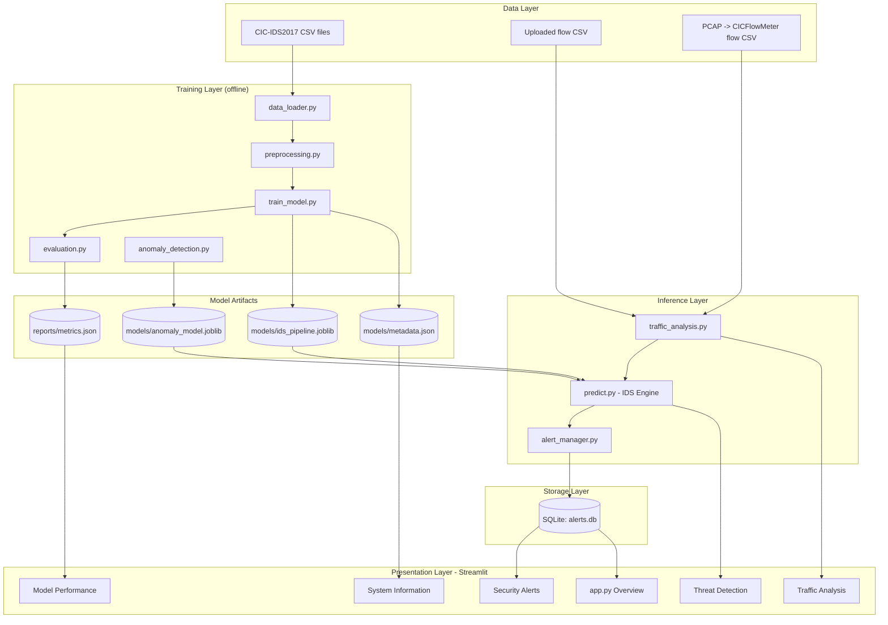

# System Architecture

## Layered Architecture



## Detection Data Flow

```
Upload CSV
   │
   ▼
[Validation]  ── size, extension, parse, required columns ──► clear error on failure
   │
   ▼
[Cleaning]    ── strip column whitespace, replace ±inf, handle NaN, coerce numerics
   │
   ▼
[Pipeline.transform] ── same fitted imputer + scaler as training (no refit)
   │
   ▼
[Classifier]  ── predicted class + probability vector
   │
   ▼
[Anomaly detector] ── anomaly score (0–1) from Isolation Forest
   │
   ▼
[Risk scorer] ── severity(class) × confidence + anomaly bonus → Low/Med/High/Critical
   │
   ▼
[Alert manager] ── dedup window, threshold filter → SQLite (status = New)
   │
   ▼
Dashboard: tables, charts, filters, CSV/report export
```

## Separation of Concerns

| Concern | Modules | Rule |
|---------|---------|------|
| Training | `data_loader`, `preprocessing`, `train_model`, `evaluation` | Never imported by UI inference path except metric reading. |
| Inference | `predict`, `traffic_analysis`, `anomaly_detection` | Loads artifacts only; never calls `fit`. |
| Persistence | `database`, `alert_manager` | Only module that touches SQLite. |
| UI | `app.py`, `pages/*` | Contains no ML logic; calls service functions. |

## Key Design Principles

1. **Leakage Prevention**: Split before any fitting; all preprocessing in sklearn Pipeline
2. **Honest Detection**: Predictions are *suspicions*, not confirmed attacks
3. **Analyst-Centric**: Alert workflow supports human review (New → Investigating → Resolved)
4. **Reproducibility**: Fixed seeds, pinned versions, metadata snapshots
5. **Security**: Parameterized SQL, upload validation, no payload storage, formula-injection neutralization